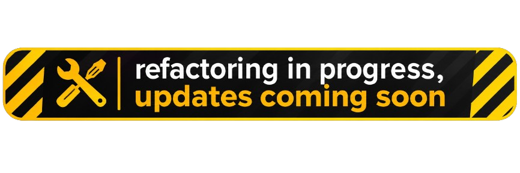

  

  

# RazorPlus

RazorPlus is a lightweight extension library that provides custom HTML Helpers to enhance productivity and readability in ASP.NET Razor views. Designed for clean, reusable, and expressive markup, it simplifies common UI patterns and helps keep your Razor pages tidy and maintainable.

### ✅ To-Do List

- [x] Refactoring

### 📦 Installation

Refactoring

### 🔭 Planned Features

Refactoring